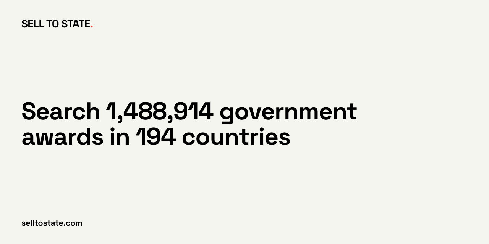

# Sell to State API reference

Source files for the public API reference. The live page is the docs link below.

This repository is a mirror. It updates when the docs source changes on `master` of the private data-atlas repository. Do not edit the spec here.

The overview does not freeze an award count. Read the current count on the site link.

## Also

- Site: [https://selltostate.com/?utm_source=github&utm_medium=referral&utm_campaign=sts-public-repos&utm_content=selltostate-api-reference](https://selltostate.com/?utm_source=github&utm_medium=referral&utm_campaign=sts-public-repos&utm_content=selltostate-api-reference)
- Countries: [https://selltostate.com/countries?utm_source=github&utm_medium=referral&utm_campaign=sts-public-repos&utm_content=selltostate-api-reference](https://selltostate.com/countries?utm_source=github&utm_medium=referral&utm_campaign=sts-public-repos&utm_content=selltostate-api-reference)
- Docs: [https://docs.selltostate.com/?utm_source=github&utm_medium=referral&utm_campaign=sts-public-repos&utm_content=selltostate-api-reference](https://docs.selltostate.com/?utm_source=github&utm_medium=referral&utm_campaign=sts-public-repos&utm_content=selltostate-api-reference)
- API keys: [https://app.selltostate.com/account/keys?utm_source=github&utm_medium=referral&utm_campaign=sts-public-repos&utm_content=selltostate-api-reference](https://app.selltostate.com/account/keys?utm_source=github&utm_medium=referral&utm_campaign=sts-public-repos&utm_content=selltostate-api-reference)
- X: https://x.com/selltostate
- https://github.com/getbeton/selltostate-api-reference
- https://github.com/getbeton/selltostate-mcp
- https://github.com/getbeton/selltostate-cli
- https://github.com/getbeton/selltostate-ts
- https://github.com/getbeton/selltostate-py
- https://github.com/getbeton/selltostate-java
- https://github.com/getbeton/selltostate-kotlin
- https://github.com/getbeton/selltostate-rust
- https://github.com/getbeton/selltostate-ror
- https://github.com/getbeton/selltostate-js
- https://github.com/getbeton/selltostate-node
- https://github.com/getbeton/selltostate-next

This package is not published to npm, PyPI, Maven Central, crates.io, RubyGems, or Homebrew.
